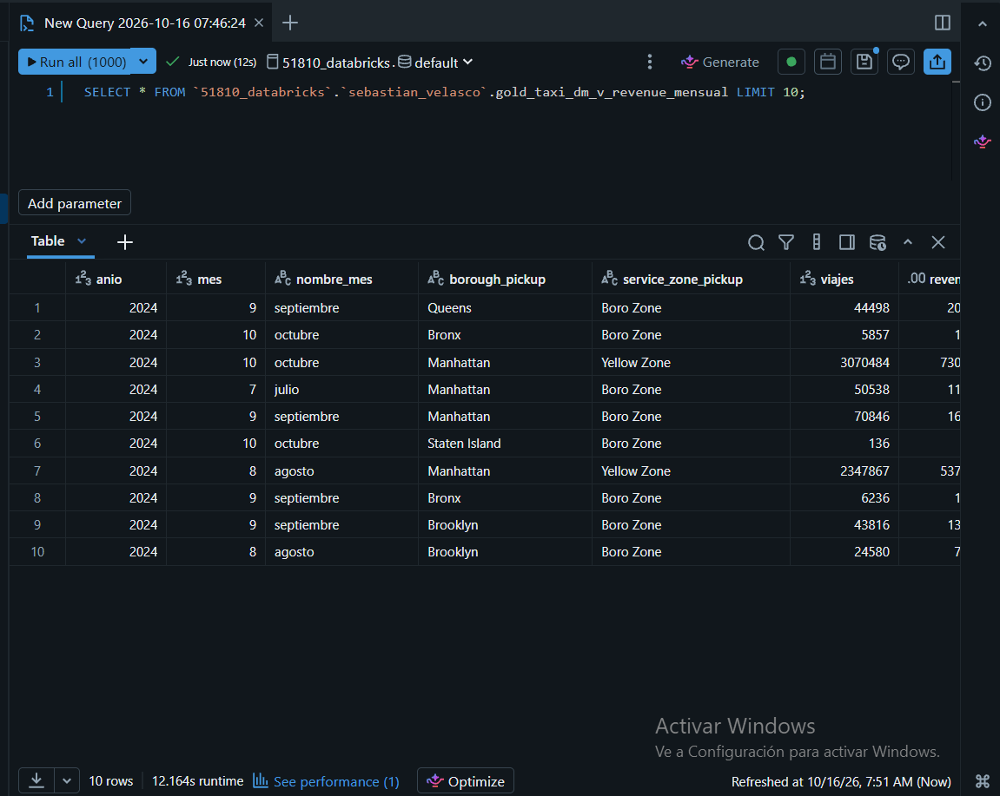
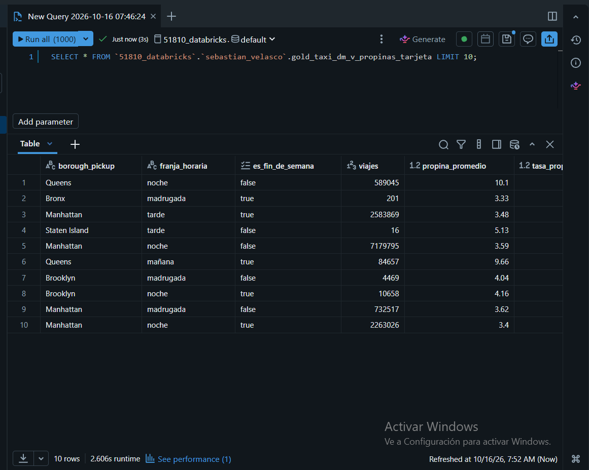
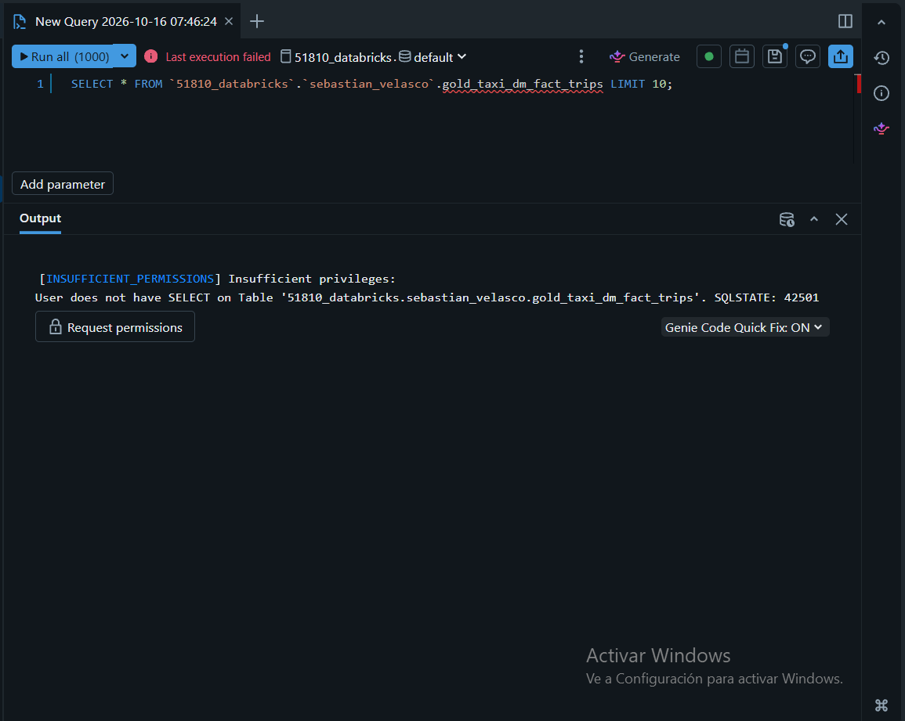
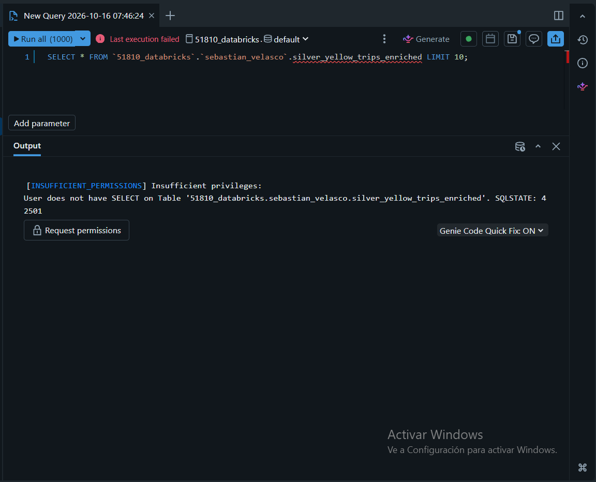

# Evidencia de permisos (Parte 3.3)

Prueba hecha por el compañero de pareja en el **SQL Editor** de Databricks, con su propio usuario, el 16 de octubre de 2026.

Permisos otorgados (notebook `03_dm_constraints_vistas_permisos`):

```sql
GRANT USE SCHEMA ON SCHEMA `51810_databricks`.`sebastian_velasco` TO `<compañero>`;
GRANT SELECT ON TABLE `51810_databricks`.`sebastian_velasco`.gold_taxi_dm_v_revenue_mensual  TO `<compañero>`;
GRANT SELECT ON TABLE `51810_databricks`.`sebastian_velasco`.gold_taxi_dm_v_propinas_tarjeta TO `<compañero>`;
```

## Salida de `SHOW GRANTS`

| Objeto | Principal | ActionType |
|---|---|---|
| `gold_taxi_dm_v_revenue_mensual` | compañero (correo omitido) | `SELECT` |
| `gold_taxi_dm_v_propinas_tarjeta` | compañero (correo omitido) | `SELECT` |
| `gold_taxi_dm_fact_trips` | compañero | *(sin SELECT: confirmado por el error de abajo)* |
| `silver_yellow_trips_enriched` | compañero | *(sin SELECT: confirmado por el error de abajo)* |

## 1. Puede consultar las vistas ✅

**`gold_taxi_dm_v_revenue_mensual`**



**`gold_taxi_dm_v_propinas_tarjeta`**



## 2. No puede consultar la tabla de hechos ni silver ❌

**`gold_taxi_dm_fact_trips`**

```
[INSUFFICIENT_PERMISSIONS] Insufficient privileges:
User does not have SELECT on Table '51810_databricks.sebastian_velasco.gold_taxi_dm_fact_trips'. SQLSTATE: 42501
```



**`silver_yellow_trips_enriched`**

```
[INSUFFICIENT_PERMISSIONS] Insufficient privileges:
User does not have SELECT on Table '51810_databricks.sebastian_velasco.silver_yellow_trips_enriched'. SQLSTATE: 42501
```



## Por qué funciona así

En Unity Catalog una vista se ejecuta con los permisos de su **dueño** sobre las tablas que consulta. Al compañero solo se le verifican sus permisos sobre la vista (`USE SCHEMA` + `SELECT`). Si consulta `fact_trips` o silver directamente, se verifican sus propios permisos sobre esas tablas, que no tiene, y recibe `INSUFFICIENT_PERMISSIONS`. Así la vista funciona como capa de seguridad para Finanzas.
